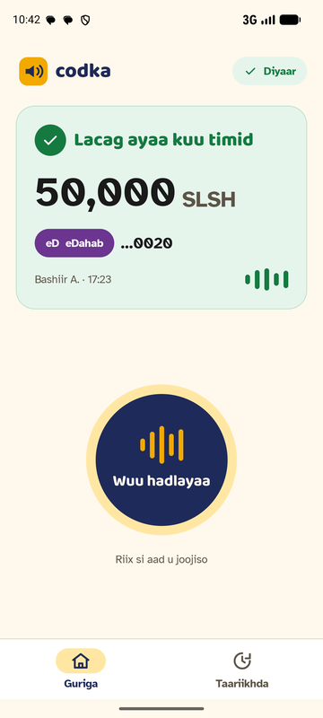
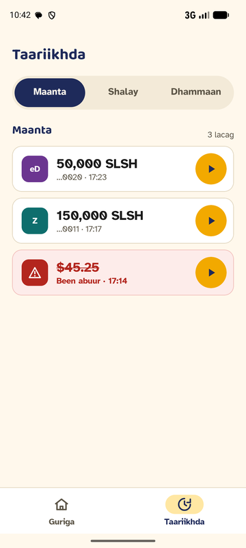

# 🔊 Codka

**Codka** ("the voice" in Somali) is an Android app for market sellers who can't read. When a Zaad or eDahab payment SMS arrives, the phone says the amount out loud in Somali, twice, so the seller knows right away if she was paid in full.

> **Status:** Version **0.2.0**, ready for the pilot with sellers in Borama. Setup, SMS → voice, the fake-SMS check, 30-day history and the helper settings screen all work, in the Codka design. Still to come: confirming the sender IDs on real phones during the pilot.

## Screens

| Setup | Home | History | Helper settings |
|:---:|:---:|:---:|:---:|
|  |  |  |  |
| Welcome, then SMS, battery and a voice test: one step per screen | The payment that just arrived, and the round **Ku celi** button to hear it again (tap while speaking to stop) | Maanta / Shalay / Dhammaan, a play button on every row; red and struck through means it may be fake | Hold the logo for 2 s: a health check with a **Hagaaji** (fix) button for each problem |

The screens follow the Codka design system (Saffron and Indigo, Baloo 2 and Atkinson Hyperlegible) and work **without reading**: green means paid, red means "careful", teal **Z** is Zaad, purple **eD** is eDahab, and the buttons speak.

## What it does

- **Speaks every payment, twice**: *"Lacag ayaa kuu timid: shan iyo labaatan doolar. Mar kale: …"*. It takes about 20 seconds, and the amount is never rounded.
- **Works with the app closed and the screen locked.**
- **Saves every payment for 30 days**, so it can be replayed. The same SMS is never saved or spoken twice, and older payments are deleted so the phone doesn't fill up.
- **Says *"Fariin aan la garanayn"*** (unknown message) for a Zaad / eDahab payment SMS it can't read, instead of guessing.
- **Ignores every other SMS**, and keeps nothing about them.
- **Warns about fake payment SMS**: if a payment SMS doesn't come from the official sender (222 / 898 for Zaad, eDahab-SHL / eDahab-USD for eDahab), or its new balance is smaller than the money received, Codka says the warning instead of the amount and the payment shows in red.

Everything runs **on the phone**: no internet, no account, no server.

## Requirements

- An Android phone with **Android 7.0 (API 24) or newer** and a SIM that receives Zaad or eDahab SMS.
- Media volume turned up: Codka speaks through the media (music) volume.

### Permissions

| Permission | Why |
|---|---|
| Receive SMS | To hear new payment SMS. Codka never sends SMS and never reads old ones. |
| Ignore battery optimisation | So phones like Tecno, Infinix and itel don't freeze Codka and drop the SMS. |
| Foreground service (media playback) | Keeps Codka alive for the few seconds it speaks. |
| Notifications (Android 13+) | Shows the "Codka is speaking" notice while it speaks. |

## Setting it up for a seller

A helper (family member, shop neighbour) sets the phone up once:

1. Install the signed APK (see [Signed APK for sellers](#signed-apk-for-sellers)).
2. Open Codka and tap **Bilow**. Follow the steps, one per screen:
   - **SMS**: tap **Oggolow** to allow Codka to see payment SMS.
   - **Battery**: choose *"Ha xadidin"* (No restrictions). On Tecno / Infinix / itel, also turn on **Auto-start** for Codka in Phone Master.
   - **Voice test**: Codka says *"Lacag ayaa kuu timid: toban doolar…"*. If you can't hear it, turn the media volume up and try again.
3. Done: the home screen shows **Diyaar** (ready). Codka now works with the app closed.

Later, **hold the Codka logo for 2 seconds** to open the helper settings: a health check (SMS permission, battery, volume, auto-start) with a **Hagaaji** (fix) button for each problem, and **Ku celi dejinta bilowga** to run setup again. On a debug build it also shows **Qalabka tijaabada** (test tools): a log of each Zaad / eDahab SMS Codka received and what it did with it (outcome and sender only, never the amount or text).

## How it works

```
SMS ─► listener ─► parser (assets/parsers.json) ─► save (Room) ─► Somali voice (recorded clips, ExoPlayer)
                                                                └► home and history update by themselves
```

1. **Listener** (`sms/SmsReceiver`): receives every new SMS and joins multi-part messages.
2. **Filter** (`sms/PaymentSmsFilter`): keeps only Zaad / eDahab payment SMS; everything else is dropped right away.
3. **Parser** (`parser/`): reads the amount, currency, sender name and phone and the new balance, using the patterns in `assets/parsers.json`.
4. **Fake check** (`sms/FakeCheck`): checks the official sender ID and that the new balance is at least the money received.
5. **Save** (`data/`): stores the payment in Room with a fingerprint of the SMS, so duplicates are ignored; deletes payments older than 30 days.
6. **Speak** (`voice/`): turns the amount into Somali words and plays the clips twice from a short foreground service.

The voice is built from 36 short recorded Somali clips (numbers, *boqol*, *kun*, *doolar*, *shilin*, phrases) joined without gaps. Phones have no Somali text-to-speech voice, so recorded clips sound right and work offline.

## Build and test

You need Android Studio (its bundled JDK 17 is enough).

```bash
./gradlew ktlintCheck testDebugUnitTest assembleDebug
```

- The tests run every anonymised SMS sample in `app/src/test/resources/sms-samples` through the real parser, database and announcer.
- The debug APK is in `app/build/outputs/apk/debug/`.
- **New SMS wording?** See [Adding or changing an SMS format](#adding-or-changing-an-sms-format).
- CI (`.github/workflows/ci.yml`) runs the same ktlint, unit tests and debug build on every push and pull request, and uploads the debug APK as an artifact.

### Signed APK for sellers

1. Once, create a signing key **outside** the repository and back it up: `keytool -genkeypair -v -keystore ../codka-release.jks -alias codka -keyalg RSA -keysize 2048 -validity 10000`
2. Copy `keystore.properties.example` to `keystore.properties` (never committed) and fill in the passwords.
3. Raise `versionCode` and `versionName` in `app/build.gradle.kts`, then run `./gradlew assembleRelease`. The APK is in `app/build/outputs/apk/release/`.

Every later version must be signed with the same key, or it won't install over the old one.

### Adding or changing an SMS format

1. Add the new SMS to `app/src/test/resources/sms-samples/` (one file per SMS), **anonymised**: fake names, numbers, balances and IDs, but the exact wording and spacing. Non-payment SMS go in `not-payment/`.
2. Add its expected result to `sms-samples/expected.json`.
3. Update or add the format in `app/src/main/assets/parsers.json`: a `marker`, a `pattern` with 3 groups (amount, sender name, sender phone) and an optional `balancePattern` (new balance).
4. Run `./gradlew testDebugUnitTest`.

## Tech stack

Kotlin · Jetpack Compose (Material 3) · Room · Media3 ExoPlayer · Coroutines · JUnit 5, Robolectric · ktlint. Built with AGP 9, `compileSdk`/`targetSdk` 36, `minSdk` 24.

## Project structure

```
app/src/main/java/com/codka/app/
├── sms/      # SMS listener and the pipeline: parse → check → save → speak
├── parser/   # Zaad + eDahab parsers
├── voice/    # Somali number words and the announcer
├── data/     # Room database: payments and settings
└── ui/       # Setup, home, history and helper screens; theme/ holds the design tokens

app/src/main/assets/parsers.json   # Zaad / eDahab SMS formats
app/src/main/res/raw/              # the recorded Somali voice clips
app/src/test/resources/sms-samples # anonymised SMS used by the tests
screenshots/                       # images used in this README
```

## Roadmap

- [x] SMS → Somali voice, twice, with the app closed
- [x] Zaad and eDahab, dollars and shillings
- [x] Fake-SMS check on sender and balance
- [x] Step-by-step setup, home, history and helper settings in the Codka design
- [x] 30-day history, signed release build (0.2.0)
- [ ] Confirm the official sender IDs on sellers' phones
- [ ] Pilot with sellers in Borama, then fix what they find

## Privacy

Codka reads only Zaad and eDahab payment SMS. For each payment it stores what it needs to replay it (amount, currency, sender name and number, new balance, time) and a fingerprint of the SMS, never the SMS text, and deletes payments after 30 days. Codka never uses the internet, app backup is turned off, and nothing leaves the phone.

## Fonts

The fonts (Baloo 2 and Atkinson Hyperlegible) are under the SIL Open Font License; their licences are in `licenses/fonts/`.
