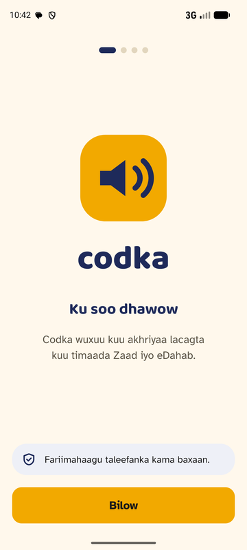
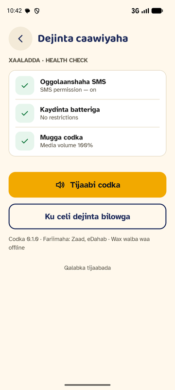

# 🔊 Codka

**Codka** ("the voice" in Somali) is an Android app for market sellers who can't read. When a Zaad or eDahab payment SMS arrives, the phone says the amount out loud in Somali, twice, so the seller knows right away if she was paid in full.

> **Status:** In development. Setup, SMS → voice, the fake-SMS check, and the home, history and helper settings screens work, in the new Codka design. Still to come: checking the sender IDs on real phones and a pilot with sellers in Borama.

## Screens

| Setup | Home | History | Helper settings |
|:---:|:---:|:---:|:---:|
|  |  |  |  |
| Welcome, then SMS, battery and a voice test: one step per screen | The payment that just arrived, and the round **Ku celi** button to hear it again (tap while speaking to stop) | Maanta / Shalay / Dhammaan, a play button on every row; red and struck through means it may be fake | Hold the logo for 2 s: a health check with a **Hagaaji** (fix) button for each problem |

The screens follow the Codka design system (Saffron and Indigo, Baloo 2 and Atkinson Hyperlegible) and work **without reading**: green means paid, red means "careful", teal **Z** is Zaad, purple **eD** is eDahab, and the buttons speak.

## What it does

- **Speaks every payment, twice**: *"Lacag ayaa kuu timid: shan iyo labaatan doolar. Mar kale: …"*. It takes about 20 seconds, and the amount is never rounded.
- **Works with the app closed and the screen locked.**
- **Saves every payment**, so it can be replayed. The same SMS is never saved or spoken twice.
- **Says *"Fariin aan la garanayn"*** (unknown message) for a Zaad / eDahab payment SMS it can't read, instead of guessing.
- **Ignores every other SMS**, and keeps nothing about them.
- **Warns about fake payment SMS**: if a payment SMS doesn't come from the official sender (222 / 898 for Zaad, eDahab-SHL / eDahab-USD for eDahab), or its new balance is smaller than the money received, Codka says the warning instead of the amount and the payment shows in red.

Everything runs **on the phone**: no internet, no account, no server.

## How it works

```
SMS ─► listener ─► parser (assets/parsers.json) ─► save (Room) ─► Somali voice (recorded clips, ExoPlayer)
                                                                └► home and history update by themselves
```

The voice is built from 36 short recorded Somali clips (numbers, *boqol*, *kun*, *doolar*, *shilin*, phrases) joined without gaps. Phones have no Somali text-to-speech voice, so recorded clips sound right and work offline.

## Build and test

You need Android Studio (its bundled JDK 17 is enough).

```bash
./gradlew ktlintCheck testDebugUnitTest assembleDebug
```

- The tests run every anonymised SMS sample in `app/src/test/resources/sms-samples` through the real parser, database and announcer.
- The debug APK is in `app/build/outputs/apk/debug/`.
- **New SMS wording?** Add an anonymised sample to `sms-samples`, then update the pattern in `app/src/main/assets/parsers.json`.

## Project structure

```
app/src/main/java/com/codka/app/
├── sms/      # SMS listener and the pipeline: parse → check → save → speak
├── parser/   # Zaad + eDahab parsers
├── voice/    # Somali number words and the announcer
├── data/     # Room database: payments and settings
└── ui/       # Setup, home, history and helper screens; theme/ holds the design tokens
```

## Privacy

Codka reads only Zaad and eDahab payment SMS. It stores a fingerprint of each payment SMS (never its text), and nothing leaves the phone.

## Fonts

The fonts (Baloo 2 and Atkinson Hyperlegible) are under the SIL Open Font License; their licences are in `licenses/fonts/`.
